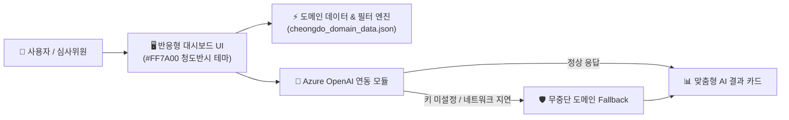

# 🍊 우리가남남이가 — 청도군 AI 바이브 코딩 해커톤 프로젝트

> **☁️ Azure 클라우드 배포 URL:** `[14:30 첫 배포 후 여기에 URL 입력]`  
> **📂 노션 워크스페이스:** [🚀 우리가남남이가 — 해커톤 대시보드](https://www.notion.so/6a0d6b9b47068339907581055342f8ab)  
> **👥 팀원:** 박범수 외 (팀 「우리가남남이가」)

---

## 📌 1. 프로젝트 개요 및 문제 정의
- **배경:** 경상북도 청도군의 지역 현안(관계인구·청년 정착, 체류형 관광 활성화, 농특산물 직거래, 고령층 교통·생활 인프라)을 데이터와 AI로 해결합니다.
- **핵심 가치:** 복잡한 회원가입이나 설정 없이 접속 즉시 체험 가능한 직관적인 대시보드와 **Azure OpenAI 기반 맞춤형 AI 분석/추천**을 제공합니다.

---

## ✨ 2. 핵심 기능 (MVP)
1. **청도군 도메인 데이터 대시보드 (`data/cheongdo_domain_data.json`)**
   - 신화랑 풍류마을, 운문사, 와인터널, 청도반시, 한재미나리, 청도 만원주택, 054 스페이스 등 10대 실제 로컬 데이터 기반 탐색 및 필터링
2. **Azure OpenAI 맞춤형 AI 솔루션 생성**
   - 사용자 조건(방문 목적 / 정착 희망 조건 / 대상 페르소나)에 맞춘 실시간 AI 분석 및 액션 플랜 카드 생성
3. **무중단 데모 Fallback 안전장치 (Zero-Failure Architecture)**
   - API 쿼터 초과나 현장 네트워크 지연 시에도 시연이 중단되지 않도록 도메인 규칙 기반 시뮬레이션 Fallback 내장

---

## 🏗️ 3. 시스템 아키텍처


---

## 🚀 4. 빠른 시작 (Local Development)

### 환경 변수 설정
```bash
cp .env.example .env
# .env 파일에 AZURE_OPENAI_ENDPOINT 및 AZURE_OPENAI_API_KEY 입력 (미입력 시 자동 Fallback 모드 작동)
```

### 바이브 코딩 단계별 프롬프트 (`prompts/`)
- `prompts/1-design.prompt.md` : 현장 주제 기반 핵심 기능 3가지 및 스키마 설계
- `prompts/2-scaffold.prompt.md` : 메인 대시보드 UI 및 청도군 실제 데이터 10선 연동
- `prompts/3-azure-ai.prompt.md` : Azure OpenAI 연동 및 무중단 Fallback 구현
- `prompts/4-deploy.prompt.md` : Azure Cloud 배포 설정 및 빌드 검증
- `prompts/5-readme-audit.prompt.md` : 16:30 2차 제출(AI 사전 검수) 대비 문서 최신화
